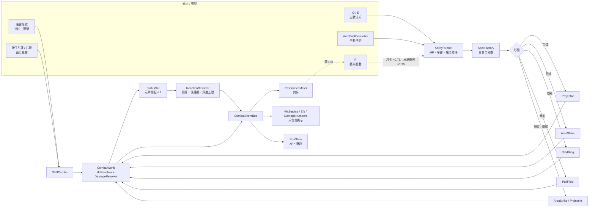
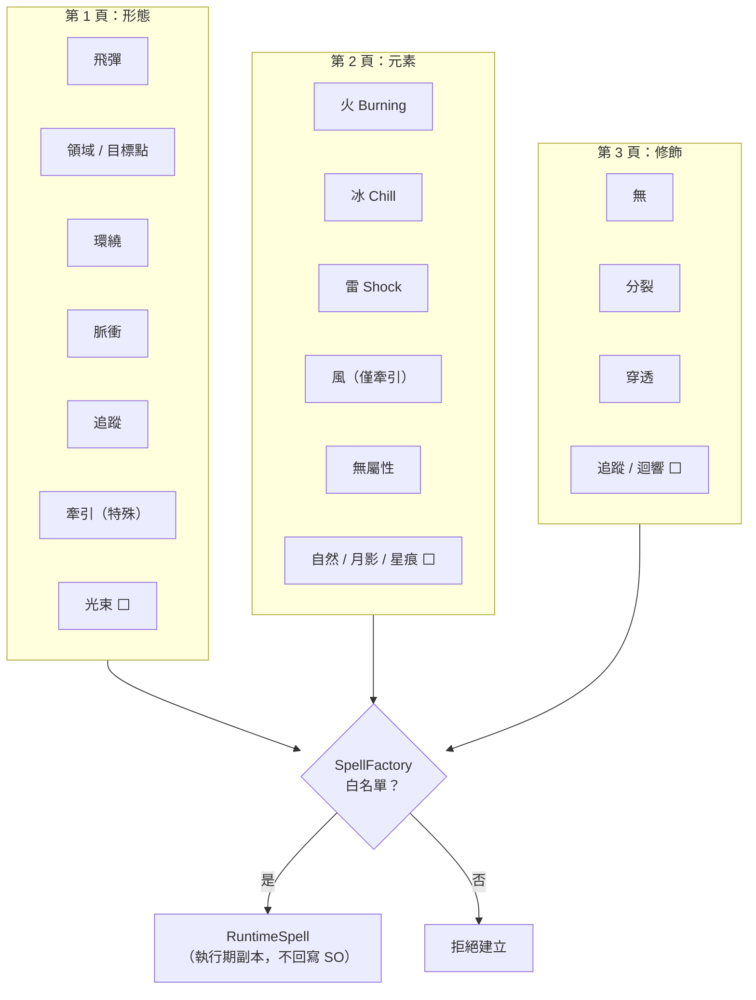
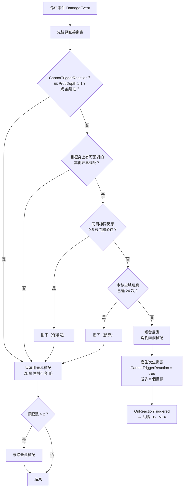
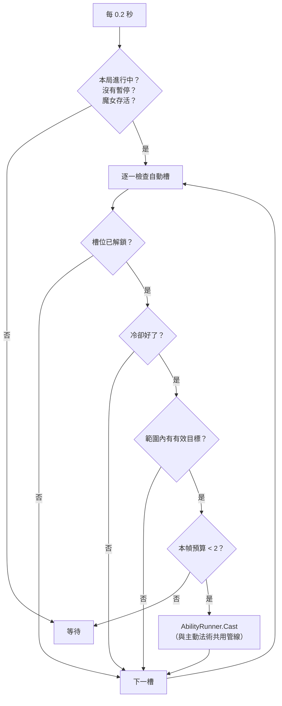
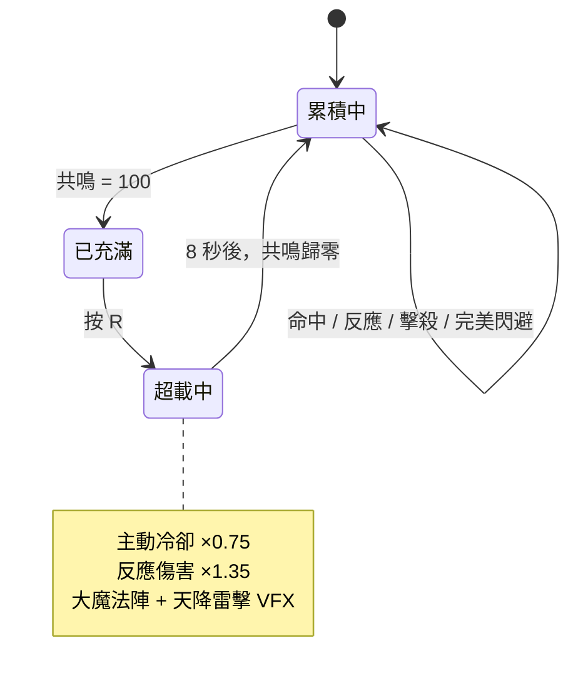
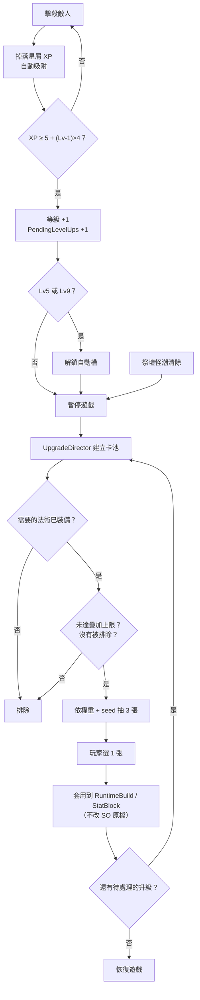
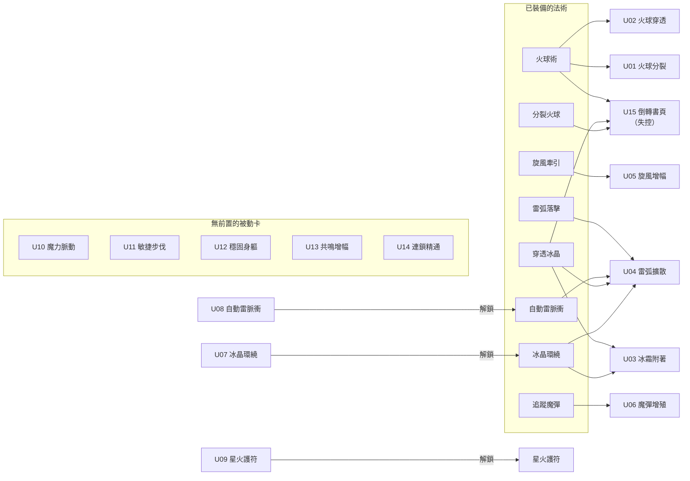
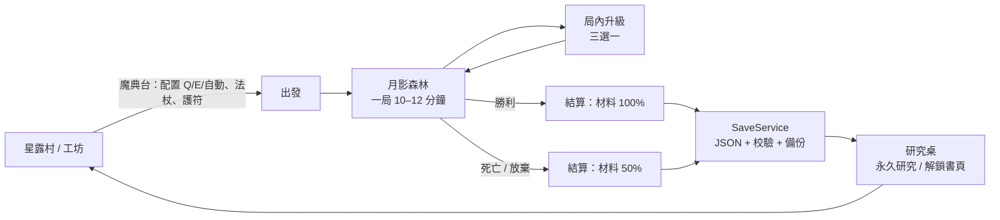

# SPELL_UPGRADE_SYSTEM.md — 法術與升級系統規劃書

> 建立：2026-11-21｜上位規格：`GAME_DESIGN_V3.md` §4–§8｜對應程式：`Assets/_Game/Scripts/{Combat,Spells,Progression,Items}`
> 本文件整理**目前已實作**的法術、元素反應、超載、升級卡、研究與裝備，並列出**規格中有但尚未實作**的項目。
> 數值都是初始設計值，還沒經過真人試玩調整。資料來源：`Editor/GameContentBuilder.cs`（法術/敵人/升級卡）、`Core/GameSession.cs`（研究節點）、`Items/Equipment.cs`（裝備）、`Combat/*`（反應、共鳴常數）。
>
> 狀態標記：✅ 已實作並有測試｜🟡 部分實作｜⬜ 規格有、未實作｜💡 本文件提出的後續構想（GDD 沒有，需確認）

---

## 1. 系統總覽

魔女的攻擊分成五層，各自獨立觸發，但都走同一條命中與傷害管線（`AbilityRunner → CombatWorld(HitResolver/DamageResolver) → ReactionResolver`）。

| 層 | 按鍵 | 內容 | 資源 | 狀態 |
|---|---|---|---|---|
| 法杖近戰 | 左鍵短按 | 三段連擊 10 / 12 / 18 | 命中回魔 | ✅ |
| 蓄力魔彈 | 按住左鍵或右鍵 | 三段 18 / 26 / 34 | 無 | ✅ |
| 主動法術 | Q / E | 2 個主動槽 | MP + 冷卻 | ✅ |
| 自動法術 | — | 最多 4 個自動槽 | 只有冷卻 | ✅ |
| 魔典超載 | R | 共鳴 100 時啟動 8 秒 | 共鳴 | ✅ |
| 閃避 | Space | 2.6 單位、無敵 0.15 秒 | CD 2.5 秒 | ✅ |

---

## 2. 三頁魔典：形態 × 元素 × 修飾

每個可構築法術 = **形態（Form）** + **元素（Element）** + **修飾（Modifier）** + **觸發方式（主動/自動）**。`SpellFactory.IsAllowed` 只接受白名單裡的組合，避免組合爆炸。

### 2.1 三頁內容

| 頁 | 目前（Demo） | 長期規劃 |
|---|---|---|
| 形態 Form | 飛彈 Missile、領域 Area、環繞 Orbit、脈衝 Pulse、追蹤 Homing、牽引 Pull（特殊） | ⬜ 光束 Beam（GDD §5.1「第二階段」） |
| 元素 Element | 火、冰、雷、風（只給旋風牽引）、無屬性 | ⬜ 自然、月影、星痕（GDD §5.2「之後」） |
| 修飾 Modifier | 分裂 Split、穿透 Pierce、（倒轉：升級卡 U15） | ⬜ 追蹤、迴響（GDD §5.1） |

### 2.2 白名單（目前 9 組）✅

| Spell ID | 名稱 | 形態 | 元素 | 修飾 | 觸發 | 取得方式 |
|---|---|---|---|---|---|---|
| `fire_bolt` | 火球術 | 飛彈 | 火 | — | 主動 | 開局已解鎖 |
| `split_flame` | 分裂火球 | 飛彈 | 火 | 分裂 | 主動 | 研究桌（星砂 14） |
| `piercing_ice` | 穿透冰晶 | 飛彈 | 冰 | 穿透 | 主動 | 開局已解鎖 |
| `chain_spark` | 雷弧落擊 | 領域 | 雷 | — | 主動 | 研究桌（星砂 10） |
| `wind_pull` | 旋風牽引 | 牽引 | 風 | — | 主動 | 開局已解鎖 |
| `frost_orbit` | 冰晶環繞 | 環繞 | 冰 | — | 自動 | 研究桌（星砂 12＋孢子 3）／升級卡 U07 |
| `thunder_pulse` | 自動雷脈衝 | 脈衝 | 雷 | — | 自動 | 研究桌（星砂 12＋星核碎片 1）／升級卡 U08 |
| `homing_missile` | 追蹤魔彈 | 追蹤 | 無 | — | 自動 | 開局已解鎖 |
| `star_fire` | 星火護符 | 追蹤 | 火 | — | 自動 | 研究桌（星砂 10）／升級卡 U09 |

開局預設配置（`ProfileData`）：Q = 火球術、E = 旋風牽引、開局自動 = 追蹤魔彈。

---

## 3. 法術數值表（初始設計值）

### 3.1 基礎攻擊 ✅

| 項目 | 數值 | 備註 |
|---|---|---|
| 法杖三連擊 | 10 → 12 → 18 | 第三段範圍震擊＋擊退＋短暫硬直；Boss 不會被無限打斷 |
| 命中回魔 | 每次攻擊事件對單一敵人首次命中 +2 MP | 每秒上限 8 |
| 蓄力魔彈 | 18 / 26 / 34 | 蓄力門檻 0.22 秒；等級越高越大、貫穿越多 |
| 完美閃避 | 被擊中瞬間在 Dash 中 | 下一發魔彈 +10；閃過精英/Boss 招式 +5 共鳴 |

### 3.2 法術 ✅

| 法術 | 傷害 | CD（秒） | MP | 範圍 / 半徑 | 狀態時間 | 其他 |
|---|---:|---:|---:|---|---:|---|
| 火球術 | 18 | 0.65 | 5 | 射程 8、速度 10 | 燃燒 4 秒 | — |
| 分裂火球 | 15 | 0.9 | 7 | 射程 7 | 燃燒 3 秒 | 命中後分裂 2 枚 |
| 穿透冰晶 | 12 | 0.8 | 6 | 射程 9、速度 12 | 冰緩 2.5 秒 | 貫穿 2、減速 30% |
| 雷弧落擊 | 22 | 2.8 | 14 | 目標點半徑 1.5 | 感電 2.5 秒 | — |
| 旋風牽引 | 8／次 | 6 | 18 | 半徑 2.5、持續 2 秒 | 風 2 秒 | 吸到燃燒敵人 → 火焰龍捲 |
| 冰晶環繞 | 8／次 | 0.5（內部 CD 0.6） | 0 | 環繞半徑 1.4 | 冰緩 2.5 秒 | 2 把冰刃 |
| 自動雷脈衝 | 12 | 5 | 0 | 搜尋 6、半徑 1.3 | 感電 2 秒 | — |
| 追蹤魔彈 | 9 | 2.5 | 0 | 搜尋 7 | — | 無屬性 |
| 星火護符 | 10 | 3 | 0 | 搜尋 7 | 燃燒 3 秒 | — |

### 3.3 元素狀態 ✅

| 狀態 | 來源元素 | 效果 |
|---|---|---|
| 燃燒 Burning | 火 | 持續傷害（DoT） |
| 冰緩 Chill | 冰 | 移動速度 -30% |
| 感電 Shock | 雷 | 受到傷害 +10% |
| 風 | 風 | 只用來和燃燒產生火焰龍捲 |

---

## 4. 元素反應 ✅

### 4.1 反應表

| 組合 | 反應 | 效果 |
|---|---|---|
| 火 + 冰 | 蒸汽爆裂 | 半徑 1.8 範圍追加傷害、白色衝擊波 |
| 火 + 雷 | 超載爆燃 | 主目標周圍範圍爆炸 |
| 冰 + 雷 | 碎晶雷暴 | 電弧跳躍附近敵人，基礎 3 跳，升級卡 U04 最多加到 8 |
| 火 + 風 | 火焰龍捲 | 3 秒移動火焰區域，同時最多 3 個 |

### 4.2 防止無限連鎖的規則

| 規則 | 數值 | 位置 |
|---|---|---|
| 每個敵人最多元素標記 | 2 個，新的取代舊的 | `StatusSet.MaxMarks` |
| 每次命中最多觸發 | 1 種反應，觸發後消耗兩個標記 | `ReactionResolver.Resolve` |
| 次生傷害 | `CannotTriggerReaction = true` | `CombatWorld` |
| 反應深度上限 | 1 | `ReactionResolver.MaxProcDepth` |
| 同目標同反應保護期 | 0.5 秒 | `ReactionResolver.ProtectionSeconds` |
| 全域每秒反應上限 | 24 次 | `ReactionResolver.MaxReactionsPerSecond` |
| 單一反應最多命中 | 8 個目標 | `ReactionResolver.MaxTargetsPerReaction` |
| 火焰龍捲同時存在 | 3 個 | `CombatWorld.MaxTornadoes` |

---

## 5. 自動施法 ✅

| 規則 | 數值 |
|---|---|
| 槽位 | 開局 2 槽（魔典台的開局自動法術 + 局內 1 槽），Lv5 解鎖第 3 槽、Lv9 第 4 槽（C-23） |
| 目標搜尋頻率 | 每 0.2 秒 |
| 每幀施法預算 | 2 次 |
| 沒有目標 | 不施放、不播粒子、不消耗預算 |
| 資源 | 不消耗 MP，只有冷卻 |

---

## 6. 魔典超載（Arcane Overdrive）✅

| 共鳴來源 | 數值 | 上限 |
|---|---:|---|
| 法杖第三段命中 | +2 | — |
| 主動法術直接命中 | +1 | 每次施法最多 +2 |
| 觸發元素反應 | +8 | 升級卡 U13 每層 +20% |
| 完美閃避精英/Boss 招式 | +5 | — |
| 擊殺敵人 | +1 | 每秒最多 +3 |

- 共鳴最高 100，空放技能不會充能。
- 按 R 啟動，持續 8 秒：**主動法術冷卻 ×0.75、反應傷害 ×1.35**；超載結束共鳴歸零。
- ⬜ 失控超載（共鳴未滿時用 HP 提前啟動）：GDD §7.2 標示為正式版候選，Demo 不做。

---

## 7. 局內升級（Roguelite）✅

### 7.1 流程

- 怪物掉落星屑 XP，自動吸附。
- 升級所需 XP：`5 + (等級 - 1) × 4`（Lv1→2 要 5，Lv2→3 要 9，Lv3→4 要 13…）。
- 升級時遊戲暫停，出現三選一卡片（滑鼠或 1/2/3）。
- 卡池依權重抽取，會檢查前置法術、排除條件、疊加上限，同一 seed 結果相同。
- 星痕祭壇怪潮清除後會額外給一次升級。

### 7.2 升級卡清單（15 張）✅

| ID | 名稱 | 類型 | 效果 | 權重 | 疊加上限 | 前置（需要其一） | 排除 |
|---|---|---|---|---:|---:|---|---|
| U01 | 火球分裂 | 主動 | 火球命中後分裂 2 枚低傷小彈 | 10 | 1 | 火球術 | — |
| U02 | 火球穿透 | 主動 | 火球額外貫穿 1 名敵人 | 10 | 2 | 火球術 | — |
| U03 | 冰霜附著 | 元素 | 冰狀態持續時間 +25% | 8 | 3 | 穿透冰晶／冰晶環繞 | — |
| U04 | 雷弧擴散 | 元素 | 碎晶雷暴電弧跳躍 +1（上限 8） | 8 | 5 | 雷弧落擊／雷脈衝／穿透冰晶／冰晶環繞 | — |
| U05 | 旋風增幅 | 主動 | 旋風牽引範圍 +20% | 8 | 3 | 旋風牽引 | — |
| U06 | 魔彈增殖 | 自動 | 追蹤魔彈每次多一枚 | 9 | 3 | 追蹤魔彈 | — |
| U07 | 冰晶環繞 | 自動 | 解鎖冰晶環繞；已有則多一把冰刃 | 10 | 4 | — | — |
| U08 | 自動雷脈衝 | 自動 | 解鎖自動落雷 | 9 | 1 | — | 已有雷脈衝 |
| U09 | 星火護符 | 自動 | 定期星火攻擊最近敵人 | 9 | 1 | — | 已有星火 |
| U10 | 魔力脈動 | 被動 | MP 回復 +20% | 7 | 3 | — | — |
| U11 | 敏捷步伐 | 被動 | 移動速度 +8% | 7 | 3 | — | — |
| U12 | 穩固身軀 | 被動 | 最大 HP +15，立即回復 15 | 7 | 3 | — | — |
| U13 | 共鳴增幅 | 被動 | 反應的共鳴獲得 +20% | 6 | 3 | — | — |
| U14 | 連鎖精通 | 被動 | 元素反應傷害 +15% | 7 | 3 | — | — |
| U15 | 倒轉書頁 | 失控 | 飛彈折返，返程傷害 60%，速度 -15% | 3 | 1 | 火球術／穿透冰晶／分裂火球 | — |

### 7.3 升級卡關聯圖

### 7.4 推薦流派（GDD §8.3）

| 流派 | 核心法術 | 關鍵卡 | 玩法 | 狀態 |
|---|---|---|---|---|
| 星雨爆發流 | 火球術、分裂火球、星火護符 | U01、U02、U09、U15 | 連續飛彈與爆破清群 | ✅ 可組出 |
| 元素反應流 | 火球術、穿透冰晶、雷弧落擊 | U03、U04、U13、U14 | 主動施法串接三種反應 | ✅ 可組出 |
| 環繞割草流 | 冰晶環繞、追蹤魔彈 | U06、U07、U11 | 走位保持傷害 | ✅ 可組出 |
| 控場旋風流 | 旋風牽引、火球術 | U05、U13、U14 | 聚怪後火焰龍捲爆發 | ✅ 可組出 |
| 魔武近戰流 | 法杖連擊、完美閃避 | ⬜ 需要近戰專屬卡 | 近戰回魔與短距離爆發 | ⬜ 正式版候選 |

> 「三種流派有明顯差異」需要真人試玩驗收，目前只有規則測試。

---

## 8. 局外成長 ✅（部分）

### 8.1 研究桌：8 個永久研究節點

| ID | 名稱 | 效果 | 等級 | 花費 |
|---|---|---|---:|---|
| `hp` | 星痕護體 | 最大 HP +10／級 | 3 | 星砂 8 / 16 / 28 |
| `mp` | 魔力迴路 | MP 回復 +15%／級 | 3 | 星砂 8 / 16 / 28 |
| `potion` | 藥劑配方 | 出發多帶 1 瓶生命藥水／級 | 2 | 星砂 6 / 14＋孢子 4 |
| `chain_spark` | 書頁：雷弧落擊 | 解鎖主動法術 | 1 | 星砂 10 |
| `split_flame` | 書頁：分裂火球 | 解鎖主動法術 | 1 | 星砂 14 |
| `frost_orbit` | 書頁：冰晶環繞 | 解鎖開局自動法術 | 1 | 星砂 12＋孢子 3 |
| `thunder_pulse` | 書頁：自動雷脈衝 | 解鎖開局自動法術 | 1 | 星砂 12＋星核碎片 1 |
| `star_fire` | 書頁：星火護符 | 解鎖開局自動法術 | 1 | 星砂 10 |

### 8.2 裝備 ✅

| ID | 名稱 | 欄位 | 效果 |
|---|---|---|---|
| `sprout_staff` | 新芽法杖（預設） | 法杖 | 法杖命中回魔 ×2（每秒上限同步提高） |
| `moonring_staff` | 月環法杖 | 法杖 | 蓄力魔彈到盡頭後折返（返程 60%） |
| `storm_staff` | 風暴法杖 | 法杖 | 每第三次有效施法追加小電弧 |
| `ember_charm` | 餘燼護符（預設） | 護符 | 燃燒時間 +25% |
| `frost_brooch` | 霜晶胸針 | 護符 | 對冰緩中的敵人傷害 +20% |

裝備效果都透過 `StatModifier` 套用，卸下可完全恢復。

### 8.3 材料與結算

| 材料 | 來源 | 用途 |
|---|---|---|
| 星砂 | 常見掉落 | 所有研究 |
| 孢子 | 蘑菇系敵人 | 藥劑、冰晶環繞 |
| 月露 | 森林探索 | ⬜ 目前沒有用途（預留給煉金台） |
| 星核碎片 | 精英、Boss | 自動雷脈衝 |
| 書頁 | 祭壇、寶箱 | 計數，⬜ 尚無消耗用途 |

- 勝利：材料 100% 保留；死亡：保留 50%，回到工坊床邊；Esc 放棄本局也只保留一半。
- 局內等級與升級卡不會保留。

### 8.4 整體成長循環

---

## 9. 未實作與後續規劃

### 9.1 規格中有、尚未實作 ⬜

| 項目 | GDD 位置 | 建議時機 |
|---|---|---|
| 光束形態 | §5.1 | 第二區域（星核礦坑）前 |
| 追蹤、迴響修飾 | §5.1 | 與光束一起 |
| 自然、月影、星痕三學派 | §5.2 | 依地區逐一加入（見 `STORY_WORLD_QUESTS.md` §3） |
| 失控書頁：貪婪、複寫、脆弱 | §5.6 | Demo 後，一次加一張 |
| 失控超載 | §7.2 | 正式版候選 |
| 魔武近戰流 | §8.3 | 正式版候選 |
| `StaffWorkshop`（法杖攻擊模式）、`AlchemyStation`（藥劑配方）、`StarTalent` | §8.4 | 煉金台目前只是擺設 |
| 帽子 / 披風欄位 | §9.2 | 正式版延伸 |

### 9.2 學派擴充構想 💡

以下是依 GDD §5.2 長期定位推演的草案，**GDD 沒有定義具體法術與反應**，加入前要先確認並回寫 GDD。

| 學派 | 狀態 | 候選法術 | 候選反應（與現有元素） |
|---|---|---|---|
| 自然 | 中毒、纏繞 | 毒花（領域）、荊棘（環繞）、藤蔓守衛（召喚） | 自然＋火＝野火蔓延；自然＋雷＝孢子放電 |
| 月影 | 詛咒、牽引 | 暗影之手（牽引）、虛空裂縫（領域） | 月影＋冰＝寂靜凍結；月影＋風＝暗影漩渦 |
| 星痕 | 複製、反彈 | 星彈（飛彈＋反彈）、星界迴響（複製上一個法術，不能複製自己） | 不和其他元素反應，改為修改規則（例如反應目標上限 +2） |

加入時要守住的上限：每次只新增一個學派；每個學派最多 2 個新反應；所有反應仍受 §4.2 的預算與深度上限限制。

### 9.3 驗證狀態

| 項目 | 驗證方式 | 結果 |
|---|---|---|
| 反應配對、標記上限、保護期、預算、深度 | EditMode | 通過 |
| 白名單、資料庫數值與 GDD 一致 | EditMode | 通過 |
| 升級卡前置、排除、疊加、雷弧上限、seed 重現 | EditMode | 通過 |
| 火球擊殺史萊姆、火→冰蒸汽爆裂、火＋風龍捲、碎晶雷暴跳 3 次、超載 8 秒 | PlayMode | 通過 |
| 手感、平衡、流派差異 | 真人試玩 | **未做** |

最新測試數量見 `FULL_BUILD_REPORT.md` §12（EditMode 51/51、PlayMode 57/57）。
