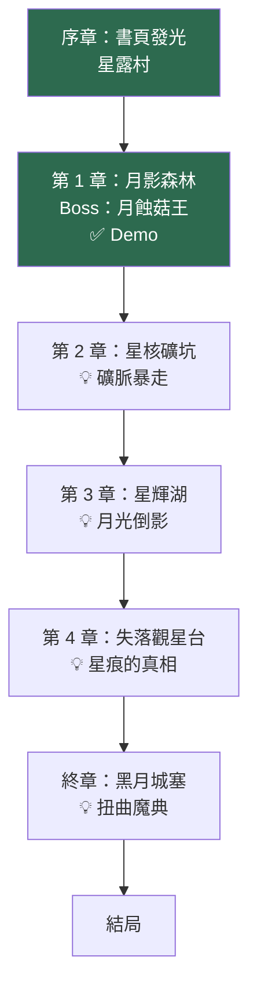
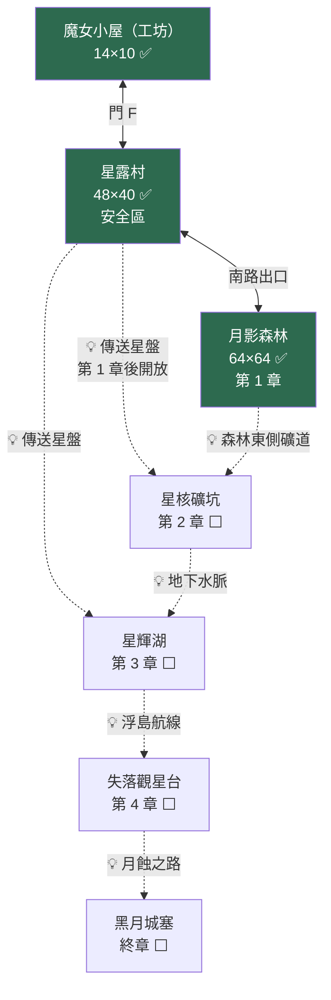
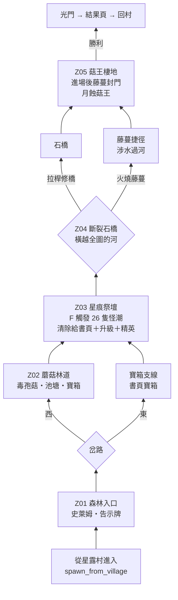
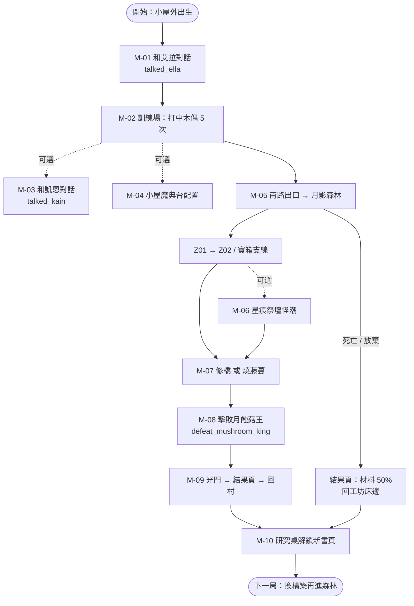

# STORY_WORLD_QUESTS.md — 故事線、世界地圖與任務清單

> 建立：2026-11-21｜上位規格：`GAME_DESIGN_V3.md` §2、§3.3–§3.4、§10.3、§11｜場景細節：`WORLD_STRUCTURE.md`
> 對應實作：`tools/map/{village,workshop,forest}.py`（NPC 台詞、物件、區域）、`World/ObjectiveTracker.cs`（目標指引）、`World/Talkable.cs` 與 `Progression/RunManager.cs`（任務旗標）。
>
> 狀態標記：✅ 已實作｜🟡 部分實作｜⬜ GDD 有、未實作｜💡 本文件提出的草案（GDD 沒寫，需要你確認後才回寫 GDD）
>
> **重要：** GDD 只寫了第一段主線（月影森林）和五個未來地區的名稱與意象。第 2 章以後的劇情、Boss、NPC 背景都是 💡 草案，供討論，不是定案。

---

## 1. 世界觀摘要（GDD §2.1）

- 世界「**艾斯特拉**」的魔法由**星痕、月影與自然元素**維持平衡。
- 星露村的魔女**露米**（暫定名）在工坊研究古老禁書《**失控魔典**》，意外喚醒書中「能自行改寫法術」的力量。
- 異常首先出現在**月影森林**：蘑菇產生毒性、古樹甦醒、星核礦脈暴走。
- 露米一邊尋找散落的魔典書頁，一邊修復魔法秩序。

### 1.1 角色

| 角色 | 身分 | 功能 | 狀態 |
|---|---|---|---|
| 露米 | 魔女，唯一可操作角色 | 玩家 | ✅ |
| 艾拉 | 老魔法研究者 | 主線指引、魔典教學、研究 | ✅ 小屋門口 |
| 凱恩 | 騎士 | 訓練場、近戰教學 | ✅ 訓練場 |
| 莉亞 | 祭司 | 回復 HP/MP、元素反應解說 | ✅ 南路 |
| 洛恩 | 弓箭手 | 森林路線與敵人情報 | ✅ 溪西 |
| 王子 | 奉國王之命調查森林異變 | 訓練場 NPC（C-29） | ✅ |
| 12 名村民 | 果農、鐵匠學徒、麵包店、商隊、信差等 | 氣氛、小提示 | ✅ 小範圍散步 |

騎士、祭司、弓箭手、王子都只是 NPC，不可操作。

---

## 2. 故事線

### 2.1 主線結構



### 2.2 序章＋第 1 章：月影森林 ✅（Demo 範圍，GDD §2.4）

| 步驟 | 劇情 | 實作狀態 |
|---|---|---|
| 1. 起床與異動 | 露米在小屋外出生，艾拉說：「魔典的書頁在發光……這不是好兆頭。」 | ✅ 艾拉台詞 |
| 2. 法杖試練 | 到訓練場找凱恩，練習三連擊、蓄力魔彈、閃避，以及火＋風＝火焰龍捲 | ✅ 凱恩台詞＋4 個木偶；打中 5 次後目標切到森林出口 |
| 3. 初次書頁 | 在工坊魔典台配置火球術、取得第一個自動魔彈 | 🟡 魔典台可配置；沒有專門的教學事件 |
| 4. 前往森林 | 從南路出口進入月影森林，遇到史萊姆 | ✅ |
| 5. 首次反應 | 取得冰／雷書頁，學會連鎖攻擊 | 🟡 開局已有穿透冰晶，莉亞會解說反應；沒有「取得書頁→教學」的事件 |
| 6. 清除異常 | 星痕祭壇怪潮、孢子精英、月蝕菇王 | ✅ |
| 7. 返回研究 | 撿取魔典殘頁，回村在研究桌解鎖新書頁 | ✅ 艾拉擊敗後台詞改變；研究桌 8 節點 |

**擊敗菇王後的台詞（已實作）**
- 艾拉：「你真的打倒了菇王！魔典殘頁上的星痕又亮了一些。」
- 王子：「月蝕菇王被打倒了？王國欠你一份大恩，魔女。」

**第 1 章伏筆（💡 建議補上）**
- 老約翰提到「年輕時見過一次月蝕，那年森林裡的菇也發紫光」→ 暗示異變以前發生過。
- 菇王掉落的殘頁上出現礦坑的星圖 → 帶出第 2 章。
- 信差歐文「森林的路被封了」→ 菇王倒下後商隊恢復通行，可作為支線回報。

### 2.3 後續章節草案 💡

下表的地區、視覺意象與核心互動來自 GDD §2.2；劇情、Boss 與新學派是草案。

| 章 | 地區 | 劇情草案 | Boss 草案 | 新學派／系統（對應 GDD §5.2） | 機關（GDD §2.2） |
|---|---|---|---|---|---|
| 2 | 星核礦坑 | 菇王殘頁指向礦坑。星核礦脈被魔典的力量改寫，礦工被困；露米發現書頁會「吃」星核來恢復力量 | 晶核魔像：身體由暴走星核組成，會吸收雷擊充能 | 光束形態、自然學派（礦坑深處的發光苔蘚） | 電晶體導電、礦車爆破、斷橋 |
| 3 | 星輝湖 | 湖面倒映著另一個星空。艾拉承認她年輕時曾封印魔典，但封印是用月影魔法做的，現在正在失效 | 湖影：模仿露米當前構築的倒影 | 月影學派、追蹤／迴響修飾 | 元素導電、浮島、橋梁機關 |
| 4 | 失落觀星台 | 觀星儀記錄了魔典作者「第一位星痕魔女」的研究：魔典本身是活的，想要改寫世界的規則 | 觀星儀守護者：用光束折射攻擊 | 星痕學派（複製、反彈、改寫規則）、失控超載 | 光束折射、星痕謎題、雪地 |
| 終 | 黑月城塞 | 月蝕降臨，魔典的意志在城塞成形，扭曲成「另一個魔女」 | 扭曲魔典／黑月魔女：三階段，各使用一個學派 | 全部學派合流 | 黑紫月蝕、古塔 |

**結局方向（💡 二選一，待決定）**
- A. 封印：露米把魔典重新封印，失去改寫法術的能力，但艾斯特拉恢復平衡。
- B. 共存：露米與魔典締結契約，成為新的「星痕魔女」，魔典從此聽她的話。

### 2.4 NPC 個人線草案 💡

| NPC | 個人線 | 解鎖時機 |
|---|---|---|
| 艾拉 | 她曾封印過魔典，一直隱瞞；第 3 章揭露 | 第 3 章 |
| 凱恩 | 年輕時在礦坑當過守衛，熟悉礦坑地形 | 第 2 章 |
| 莉亞 | 淨化魔法能削弱失控書頁的代價（對應失控書頁系統） | 第 2 章後 |
| 洛恩 | 森林隱藏區域與狩獵委託 | 第 1 章後（支線） |
| 王子 | 回王都報告後，帶來國王的委託與城塞情報 | 第 4 章 |

---

## 3. 世界地圖

### 3.1 地區總覽

| 地區 | 視覺 | 核心互動 | 開發進度 |
|---|---|---|---|
| 星露村／魔女小屋 | 青綠草地、粉色花樹、紫瓦木屋、暖色窗光 | 工坊研究、NPC、訓練場 | ✅ Demo |
| 月影森林 | 深綠樹冠、蘑菇、河谷、古代石柱 | 藤蔓燃燒、怪潮、首 Boss | ✅ Demo |
| 星核礦坑 | 藍紫晶礦、礦車、斷橋 | 電晶體、礦車爆破 | ⬜ 未來 |
| 星輝湖 | 月光水面、浮島、水晶遺跡 | 元素導電、橋梁機關 | ⬜ 未來 |
| 失落觀星台 | 高山、雪、機械觀星儀 | 光束折射、星痕謎題 | ⬜ 未來 |
| 黑月城塞 | 黑紫月蝕、古塔、扭曲魔典 | 後期 Boss、結局 | ⬜ 未來 |

### 3.2 世界連接圖

連接方式除了「村莊 ↔ 森林」以外都是 💡 草案。GDD 規定不做無限開放世界，所以每個地區都是獨立的手工場景，從星露村出發。



> 傳送星盤目前只會把魔女傳回小屋門口（`LocalTeleport`）。💡 建議之後改成地區選擇器，作為通往已解鎖地區的入口。

### 3.3 星露村（48×40）✅

```text
 y=40 ┌────────────────────────────────────────────────┐
      │ 樹林邊界（樹冠遮擋）                              │
      │ 西側高台  ┌魔女小屋┐ 魔女小院  紫帳篷  南瓜田      │
      │ 池塘瀑布  └──門──┘ 艾拉                          │
      │ 崖面(2格) 石階                                   │
      │ 溪流   中央廣場 ★出生 ── 東路 ── 傳送星盤(噴泉)    │
      │  ══木橋══ 路牌                                   │
      │ 洛恩(溪西)       │          騎士訓練場             │
      │ 蜜拉・貝克        │     凱恩・王子・4 木偶・箭靶   │
      │          莉亞(南路)                              │
      │                南路                             │
 y=0  └────────────── 森林出口 ─────────────────────────┘
```

| 區域 ID | 名稱 | 內容 |
|---|---|---|
| `cottage` | 魔女小屋 | 門 → 工坊；艾拉；魔女小院 |
| `plateau` | 西側高台 | 池塘、瀑布、2 格高崖面 |
| `bridge` | 溪畔小橋 | 木橋、洛恩、蜜拉、貝克 |
| `training` | 騎士訓練場 | 凱恩、王子、4 個打不倒的木偶、提姆 |
| `exit` | 森林出口 | 森林告示牌、往 Forest |
| `square` | 星露村・中央廣場 | 出生點、路牌、傳送星盤 |

### 3.4 魔女小屋室內（14×10）✅

| 設施 | 功能 |
|---|---|
| 魔典台 | 配置 Q/E、開局自動法術、法杖、護符 |
| 研究桌 | 8 個永久研究節點 |
| 床 | 回復、補藥水、存檔 |
| 煉金台＋大鍋 | ⬜ 目前只是擺設（GDD §8.4 `AlchemyStation`） |
| 門 | 回星露村 |

### 3.5 月影森林（64×64）✅



| Zone | 範圍 | 敵人 | 互動物件 |
|---|---|---|---|
| Z01 森林入口 | y 0–15 | 史萊姆為主，少量幽光 | 森林告示牌 |
| Z02 蘑菇林道 | y 15–32 | 史萊姆、毒孢菇、幽光 | 寶箱 ×2（東側支線寶箱含書頁） |
| Z03 星痕祭壇 | y 32–46 | 四種混合（樹根守衛少量）、祭壇怪潮 | 星痕祭壇、6 石柱 |
| Z04 斷裂石橋 | y 46–53 | 四種混合，樹根守衛比例最高 | 斷橋拉桿、可燃藤蔓 |
| Z05 菇王棲地 | y 53–64（禁止一般生成） | 月蝕菇王 | Boss 場地、8 石柱、光門 |

**敵人**

| 敵人 | HP | 傷害 | 行為 |
|---|---:|---:|---|
| 苔蘚史萊姆 | 45 | 10 | 追擊、接觸傷害 |
| 毒孢菇 | 55 | 12 | 保持距離、蓄力吐孢子 |
| 樹根守衛 | 140 | 20 | 紅色預警 → 衝鋒 → 破防硬直 |
| 迷途幽光 | 35 | 8 | 繞圈 → 預警 → 突刺 |
| 孢子精英 | 350 | 15 | 五向孢子扇、地面重擊、召喚史萊姆 |
| 月蝕菇王 | 2200 | 16 | 三階段（見 §4.1 M-08） |

怪潮：依時間 0–12 分鐘調整同屏數，上限 60；6 分鐘或祭壇怪潮後出現精英；Boss 戰停止一般生成。

### 3.6 未來地區的地圖草案 💡

| 地區 | 建議大小 | 區域骨架草案 |
|---|---|---|
| 星核礦坑 | 64×80（縱長） | 礦坑入口 → 礦車軌道（爆破開路）→ 晶礦大廳（怪潮）→ 斷橋深谷 → 核心礦室（Boss） |
| 星輝湖 | 80×64 | 湖畔營地 → 浮島群（導電機關連接）→ 水晶遺跡（怪潮）→ 湖心（Boss） |
| 失落觀星台 | 64×96（爬升） | 山腳 → 雪道（光束折射謎題）→ 觀星儀廣場 → 塔頂（Boss） |
| 黑月城塞 | 96×96 | 城門 → 三座古塔（各一學派試煉）→ 中央大廳（終局 Boss） |

---

## 4. 任務清單

> 目前**沒有獨立的任務系統**。`ObjectiveTracker` 從遊戲狀態推導「下一步去哪」，任務完成只存成 `ProfileData.completedQuests` 裡的旗標字串。若後續任務增加，💡 建議改成 `QuestDefinition`（ScriptableObject）＋ `QuestLog`，並保留現有旗標 ID 以相容舊存檔。

### 4.1 主線任務（第 1 章）

| ID | 任務 | 觸發 | 完成條件 | 目標指引（小地圖） | 獎勵 / 結果 | 狀態 |
|---|---|---|---|---|---|---|
| M-01 | 書頁的異動 | 開始遊戲 | 和艾拉對話 | — | 旗標 `talked_ella` | ✅ |
| M-02 | 法杖試練 | M-01 後 | 打中訓練木偶 5 次 | 「訓練場」 | 目標改為森林出口 | ✅（`TrainingHits`，只算本次遊玩） |
| M-03 | 騎士的指導 | 到訓練場 | 和凱恩對話 | — | 旗標 `talked_kain` | ✅ |
| M-04 | 初次書頁 | 進小屋 | 在魔典台配置法術 | — | — | 🟡 可操作，無任務追蹤 |
| M-05 | 前往月影森林 | M-02 後 | 從南路出口進入森林 | 「南路・往月影森林」 | 載入 Forest | ✅ |
| M-06 | 星痕祭壇 | 抵達 Z03 | 在祭壇按 F，清除 26 隻怪潮 | — | 書頁＋額外升級＋精英出現 | ✅（選擇性） |
| M-07 | 渡過斷橋 | 抵達 Z04 | 拉桿修橋，或用火燒開藤蔓 | — | 通往 Z05 | ✅ |
| M-08 | 擊敗月蝕菇王 | 進入 Z05 | 打倒 Boss | 「菇王棲地」→「月蝕菇王」 | 旗標 `defeat_mushroom_king`、魔典殘頁 | ✅ |
| M-09 | 返回研究 | M-08 後 | 走進光門回村 | 「光門」 | 結果頁、材料 100%、艾拉與王子台詞改變 | ✅ |
| M-10 | 新的書頁 | M-09 後 | 在研究桌完成任一研究 | — | 解鎖新法術 | 🟡 可操作，無任務追蹤 |

**月蝕菇王三階段（M-08）**

| 階段 | HP | 行為 |
|---|---|---|
| P1 | 100–70% | 瞄準孢子彈、地面毒圈 |
| P2 | 70–35% | ＋召喚小怪、環形孢子 |
| P3 | 35–0% | 加速、交錯預警區；招式後弱點暴露 2 秒（受傷 ×1.5） |

大招前搖 ≥ 0.7 秒並有地面預警；換階段時 1 秒無敵。



### 4.2 第 1 章支線

| ID | 任務 | 委託人 | 內容 | 狀態 |
|---|---|---|---|---|
| S-01 | 祭司的祝福 | 莉亞 | 對話後 HP/MP 全回復，並解說三種元素反應 | ✅（可重複，無旗標） |
| S-02 | 森林情報 | 洛恩 | 對話取得森林路線、祭壇、斷橋、樹根守衛提示 | ✅（只有對話） |
| S-03 | 王子的委託 | 王子 | 對話；擊敗菇王後台詞改變 | ✅（只有對話） |
| S-04 | 東側寶箱 | — | 森林岔路東側支線寶箱（含書頁） | ✅ |
| S-05 | 狩獵委託 | 洛恩 | 💡 擊敗 N 隻毒孢菇，帶回孢子 | ⬜（GDD §2.3「狩獵委託」） |
| S-06 | 守衛任務 | 凱恩 | 💡 怪潮時間內守住森林入口 | ⬜（GDD §2.3「守衛任務」） |
| S-07 | 遺物鑑定 | 莉亞 | 💡 帶回森林遺物，由莉亞解說效果 | ⬜（GDD §2.3「遺物解說」，遺物系統未做） |
| S-08 | 隱藏區域 | 洛恩 | 💡 找到斷橋附近藤蔓後的隱藏區（WORLD_STRUCTURE §4 已預留位置） | ⬜ |
| S-09 | 被困的信 | 歐文（信差） | 💡 擊敗菇王後幫他把信送進森林 | ⬜ |
| S-10 | 商隊復通 | 卡洛（商隊） | 💡 擊敗菇王後商隊恢復通行，解鎖紫帳篷商店 | ⬜（商店不在 Demo 範圍） |
| S-11 | 發光的花 | 蜜拉（花店） | 💡 從星痕祭壇附近帶回夜光花 | ⬜ |
| S-12 | 星莓收成 | 湯姆（果農） | 💡 清掉果園邊的毒化蘑菇 | ⬜ |

### 4.3 永久成長目標（類任務）

| 目標 | 條件 | 狀態 |
|---|---|---|
| 研究全部 8 節點 | 研究桌全部完成 | ✅ 可達成（無成就通知） |
| 解鎖全部 9 個白名單法術 | 研究＋開局 | ✅ 可達成 |
| 統計 | `runs`、`victories`、`deaths`、`bestClearTime` 已存檔 | ✅ 有記錄、⬜ 無 UI 顯示 |

### 4.4 後續章節主線草案 💡

| 章 | ID | 任務草案 |
|---|---|---|
| 2 | M2-01 ~ M2-06 | 研讀殘頁星圖 → 凱恩帶路到礦坑 → 救出被困礦工 → 礦車爆破開路 → 晶礦大廳怪潮 → 擊敗晶核魔像 |
| 3 | M3-01 ~ M3-06 | 湖畔營地調查 → 連通浮島導電機關 → 艾拉的告白 → 水晶遺跡怪潮 → 擊敗湖影 → 取得月影書頁 |
| 4 | M4-01 ~ M4-05 | 王子帶來國王委託 → 雪道光束折射謎題 → 解讀觀星儀紀錄 → 擊敗觀星儀守護者 → 取得星痕書頁 |
| 終 | M5-01 ~ M5-05 | 月蝕降臨 → 三座古塔學派試煉 → 中央大廳 → 擊敗扭曲魔典 → 結局選擇 |

---

## 5. 待決定事項

| # | 問題 | 選項 | 影響 |
|---|---|---|---|
| Q-1 | 第 2 章以後的劇情草案是否採用 | 採用／修改／另寫 | 採用後回寫 GDD §2 並記入 §20 版本表 |
| Q-2 | 結局方向 | A 封印／B 共存／多結局 | 終章設計與失控書頁的劇情意義 |
| Q-3 | 是否建立正式任務系統 | 保持旗標＋ObjectiveTracker／改用 QuestDefinition | 支線數量超過 5 個時建議改 |
| Q-4 | 傳送星盤是否改為地區選擇器 | 是／否 | 第 2 章入口 |
| Q-5 | 主角正式名稱 | 「露米」是否定案 | 台詞、UI |
| Q-6 | 王子是否加入主線 | 只當 NPC／成為主線關鍵角色 | 第 4 章、終章 |
