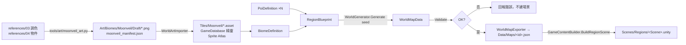

# WORLD_GENERATOR_SPEC.md — Witch World Studio 技術規格

> 版本 v1.1（2026-11-26，第二輪：石階、斷橋、藤蔓閘門、地面貼花、直向橋、森林碎塊清除、閘門可達性驗證）｜實作：`Assets/_Game/Scripts/World/Studio/`、`Assets/_Game/Editor/WorldStudio/`
> 上位：`WORLD_DESIGN.md`（世界與區域）、`TECH_ARCHITECTURE.md`（Tilemap、Sorting、碰撞）
> 選單：`Tools / Witch World / World Studio`，以及 `Tools / Witch World / Rebuild Moonveil Forest`

## 1. 目標與非目標

| 目標 | 說明 |
|---|---|
| 可重現 | 同一 Blueprint＋同一 seed，產出逐格相同（EditMode 測試 `SameSeedSameMap`） |
| 可擴充 | 新區域只需新增 Biome／POI／Blueprint 資料與一份美術 manifest，不改產生器程式 |
| 可驗證 | 產生後必跑 Validation；失敗則不建場景（見 §7） |
| 不動既有系統 | 戰鬥、法術、元素反應、任務、存檔、角色控制沿用；區域場景由既有 `GameContentBuilder` 建出，物件型別（寶箱、祭壇、Boss 區、出口、告示牌）完全共用 |
| 不是 | 無限世界、執行期隨機地圖、把參考圖貼成背景 |

產生在 **Editor 時期**執行，輸出可 diff 的地圖 JSON 並提交版控。Runtime 讀取已烘好的場景，不在遊戲中產生地圖（避免載入成本與不可重現的 Bug）。

## 2. 管線總覽

## 3. 資料結構

### 3.1 ScriptableObject（靜態設計資料，Runtime 不寫回）

| 類別 | 路徑（Moonveil） | 欄位重點 |
|---|---|---|
| `BiomeDefinition` | `Data/World/Moonveil/BIO_moonveil.asset` | 各地形角色 Tile（ground、darkGround、path、paver、water、cliffFace/Rim/Waterfall、details[]）；`catalog`（PropSpec：精靈、像素尺寸、碰撞腳印、是否淡出、光源）；`rules`（PropRule）；森林牆樹種與權重、樹距、深林保留率；橋、路燈精靈；花草覆蓋率；全域光色/強度、背景色、角色暗化、環境光點數 |
| `PoiDefinition` | `Data/World/Moonveil/POI_*.asset` | kind、名稱、空地半徑與邊界雜訊、地面樣式、石板半徑、安全區、`stamps`（固定物件＋偏移）、`objects`（玩法物件）、`clearCore`（散佈物件避開半徑）、`roadStop`（道路不鋪土的廣場半徑） |
| `RegionBlueprint` | `Data/World/Moonveil/REG_moonveil_forest.asset` | id、場景名、使用的 chapterId、目標文字、尺寸、預設 seed、biome、`pois`（key＋POI＋座標＋區名）、`roads`（from/to＋via 控制點＋種類＋寬度＋蜿蜒）、`water`（湖：中心＋半徑；河：控制點＋寬＋尾端水潭）、`cliffs`（高台南緣折線＋石階＋是否在石階設 Boss 閘門）、`exits`、入口出生點 |

### 3.2 Runtime 純資料（`WorldMapData`，不入資產）

每格一個 byte 的圖層（row-major，y 向上）：

| 圖層 | 值 | 用途 |
|---|---|---|
| `Open` | 0/1 | 已挖空（空地、道路走廊、岸邊、水體）。0 = 森林牆 |
| `Ground` | 0 草地 / 1 暗林地 | 樹冠陰影、森林地面 |
| `Surface` | 0 / 1 土路 / 2 石板 | 道路與廣場 |
| `Water`、`Bridge` | 0/1 | 水面；道路與水重疊處成為橋（可行走） |
| `Cliff` | 0 / Face / Waterfall / Rim | 2 格高懸崖立面、瀑布、高台頂緣 |
| `Detail` | `DetailKind` | 小花、苜蓿、碎石、發光小菇、花瓣（Detail Tilemap） |
| `Blocked` | 0/1 | 權威碰撞 → Collision Tilemap |
| `Spawn` | 0 阻擋 / 1 可走不生怪 / 2 可生怪 | → `SpawnGrid` |
| `Zone` | POI index+1 | 區名與敵人組成分層 |
| `Plateau` | 0/1 | 高台（資訊用） |

另有 `Props`（精靈、位置、來源規則、是否淡出、碰撞矩形）、`Pois`、`Objects`（chest/altar/sign_post/boss_arena/exit/bridge）與 `Log`。

### 3.3 列舉

`PoiKind`（Entrance、Altar、AncientTree、MushroomGrove、Lake、Camp、Gathering、CrystalGrove、BossArena、Waterfall、Junction）、`RoadKind`（Main 3 格、Side 2.2 格、Trail 1.6 格）、`WaterKind`、`PropHabitat`（ForestWall、ForestEdge、Clearing、Roadside、Shore、WaterSurface）、`GroundStyle`、`DetailKind`。

## 4. 產生流程（`WorldGenerator.Generate`，v1）

所有隨機來自 `GameRng(seed)`（xorshift128+）與無狀態雜湊雜訊 `WorldNoise`；不使用 `UnityEngine.Random`。

1. **空地**：每個 POI 以「角度雜訊扭曲的橢圓」挖空，標記 Zone；必要時鋪石板圓。
2. **水域**：湖＝雜訊橢圓（外圈 +2.5 格岸邊）；河＝Catmull-Rom 樣條＋寬度雜訊，兩側留 1.6 格岸；可選尾端水潭。
3. **道路**：樣條穿過 via 點，加入「兩端漸弱」的法向蜿蜒；逐點蓋圓：土路本體＋道路走廊（Main 兩側 2.2＋雜訊）。遇水改標 Bridge；進入終點 POI 的 `roadStop` 半徑內不鋪土（廣場留給固定物件）。主路每 1 格取樣供路燈使用。
4. **懸崖**：沿折線（加整數階梯式雜訊）在高台南緣畫 2 格立面；石階處為 `Stairs` 格（可走，石階 Tile）；河流穿越處改為瀑布；高台內全為 Rim。可選擇在第一個石階頂端生成 Boss 閘門。
4b. **森林碎塊**：被空地包圍、小於 48 格且不接地圖邊界的森林塊改為空地（太小放不下樹，否則會成為暗色隱形牆）。
5. **定案碰撞**：未挖空、非橋水面、立面、瀑布、地圖邊界皆阻擋；出口矩形內開放。
6. **清除孤島**：從入口 BFS，無法到達的可走格轉為森林（例：高台上河岸），確保沒有怪物會生在玩家到不了的地方。
7. **距離場**：到森林、到道路、到水的 4 鄰 BFS 距離。
8. **地面**：森林格＝暗林地；空地距森林 ≤1–2 格（雜訊）也染暗，形成樹冠陰影過渡。
9. **地面細節**：低頻雜訊花叢（粉/紫依色相雜訊）、菇谷附近發光小菇、路邊碎石、零星苜蓿與花瓣。
10. **物件**（依序，互相以空間清單保持間距）：
    1. POI 固定物件（stamps）
    2. 橋：同一條路的連通橋格成一座橋。方向依水流判斷（橋兩端外側仍是水→河南北流→東西向橋；反之用直向橋精靈）。`RoadSpec.brokenBridge` 的橋改為 `bridge_stone`（斷橋精靈＋修復後精靈＋缺口＋拉桿，拉桿放在 `from` 端旁可走的非路格），並登記為閘門
    3. 主路路燈（左右交替、間距 13 格、離路緣、碰撞不得壓路）
    4. 森林牆樹（錯位六角格＋樹距比例抖動；距空地 >4 格依 `deepForestKeep` 稀疏；靠邊的樹才掛 OcclusionFader；深林樹不加碰撞器，碰撞由 Tilemap 負責）
    5. 規則散佈：每條 PropRule 收集合格格子→洗牌→機率×偏好倍率→間距檢查→碰撞矩形不得壓到路或橋
11. **生怪層**：可走格預設可生；橋、石階、入口安全半徑、安全 POI（入口、營地、Boss 區）為不生怪。
12. **玩法物件**：POI objects 轉為世界座標；Boss 區自動帶觸發矩形、生成點與石階閘門；`RoadSpec.vineGateAt` 在道路該處量測整條可走走廊寬度，放置可燒藤蔓（`vine`）並登記為閘門；加入出口。

時間：160×120 的紫幻森林，產生＋驗證約 **45–50 ms**（Editor，Apple M2）。

## 5. 場景輸出（Tilemap 圖層與 Sorting）

| GameObject | Sorting Layer / Order | 內容 |
|---|---|---|
| `Grid/GroundBase` | Ground 0 | `PeriodicTile`：128 px 週期草地（4×4 切片，依 x%4、y%4 取片，隱藏 32 px 重複） |
| `Grid/GroundDark` | Ground 5 | 暗林地 256 遮罩自動拼接 |
| `Grid/Water` | Ground 10 | 星光水面＋石岸 256 遮罩 |
| `Grid/Path` | Ground 20 | 土路 256 遮罩 |
| `Grid/Paver` | Ground 22 | 遺跡石板 256 遮罩 |
| `Grid/Detail` | Ground 25 | 透明細節 VariantTile（每種 2 變體） |
| `Grid/Cliff` | Ground 30 | 懸崖立面（EastWestNorth 8 片）、瀑布、石階（`S`，EastWestNorth 8 片）、高台緣 |
| `Grid/Collision` | WorldUI 100，僅 Editor 可見 | `DBG_block`＋`TilemapCollider2D`（不用 Composite，見 C-17） |
| `Objects/Bridge` | Ground 35 | 橋（貼花，非碰撞） |
| `World/Props/Chunk_x_y` | World（Pivot 排序） | 物件 Prefab 實例，16×16 格分塊 |

- 每格不產生 GameObject；地形全部走 Tilemap Chunk 模式。
- 物件 Prefab 依（精靈＋碰撞＋淡出）共用，放在 `Prefabs/Props/Draft/PROP_mv_*.prefab`。
- 發光物件：每區最多 56 個 `Light2D`，彼此至少 5 格（固定物件 2.2 格），優先序：POI 固定物件 → 路燈 → 其他（`WorldMapExporter.ChooseLights`）。
- 一個 Biome 一張 Sprite Atlas V2（`ATL_moonveil.spriteatlasv2`，Point、無壓縮、不旋轉、padding 2）。

## 6. 地圖 JSON 契約

與 `tools/map/*.py` 相同格式（`GameContentBuilder.MapDef`），新增欄位：

- `biomeAsset`：BiomeDefinition 路徑；有此欄時 Builder 走 Studio 圖層與光照。
- `generator`：`WitchWorldStudio v<版本>`；`seed`。
- `layers.dark`（`d`）、`layers.detail`（`1`–`6`）、`layers.path` 內 `v` 表石板。
- `props[].light`：`[r,g,b,radius,intensity,ox,oy]`；`props[].layer = "GroundDecal"`：地面貼花（`PoiStamp.ground`）。
- `layers.cliff` 的 `S` = 石階；物件 `bridge_stone`：`sprite`（斷橋）、`openSprite`（修復後）、`rect`、`gap`、`lever`；`vine`：`block`。
- `scene.intro`／`scene.runObjective`：區域沿用既有章節時，覆蓋章節開場通知與推進目標（`SceneConfig.runIntro/runObjective`）。
- 區域 `zones[].id` 使用 SpawnDirector 敵人組成分層（Z01 入口 … Z05 Boss），名稱顯示 POI 區名。

## 7. 驗證（`WorldMapData.Validate`）

| 檢查 | 失敗時 |
|---|---|
| 入口出生點可走 | 錯誤 |
| 每個可走格都能從入口到達；每個可生怪格可到達 | 錯誤 |
| 每個 POI 中心附近（0.75×最大半徑）有可到達格 | 錯誤 |
| 任何阻擋物件的碰撞矩形不得覆蓋土路或橋格 | 錯誤（例：營火、祭壇石柱曾擋路，已修正） |
| 地圖邊界不可走（出口除外） | 錯誤 |
| 所有可選閘門（斷橋缺口、藤蔓）**關閉時**每個 POI 仍可到達 | 錯誤（機關只能是捷徑，不能卡關） |

另由 EditMode 測試保證：同 seed 同圖、不同 seed 形狀不同、橋/立面/閘門存在、Boss 高台只能經石階進入（封住閘門列後 Boss 中心不可達）、JSON 可被 `JsonUtility` 讀回且列寬一致、光源數量在上限內。

## 8. 測試

| 檔案 | 內容 |
|---|---|
| `Tests/EditMode/WorldStudioTests.cs` | 11 例（v1.1 新增：直向橋＋藤蔓閘門會被可達性驗證抓到、斷橋拉桿在來路側且可走、紫幻森林含兩個第 1 章機關/石階/魔法陣）；v1 的 8 例：可重現、seed 差異、合成藍圖（河＋橋＋石階＋閘門）、安全區不生怪、PeriodicTile 取片、紫幻森林驗證與拓撲、Boss 後門檢查、JSON 契約 |
| `Tests/PlayMode/MoonveilPlayTests.cs` | 4 例：場景載入（8 個圖層有圖、19,200 格地面、RunManager、小地圖、>500 個 Moonveil 物件）、森林牆擋住玩家、步行過橋、Boss 閘門位於觸發區下方 |
| `GameEvidenceCapture.CaptureMoonveil` | Evidence 類別：13 張實機畫面＋半解析度全圖 → `docs/evidence/moonveil/` |

## 9. 擴充新區域的步驟

1. 準備美術：仿 `tools/art/moonveil_art.py` 輸出 `<biome>_manifest.json`（tiles：periodic / mask256 / cliff / rim / detail；props：精靈＋pivot＋footprint＋fade＋light）。
2. 新增 Preset（仿 `MoonveilPreset.cs`）或在 Inspector 建 Biome／POI／Blueprint 資產。
3. World Studio：選 Blueprint → Generate Preview（只看圖不動場景）→ 修 Blueprint → Build Scene。
4. 把 Preset 加入 `WorldStudioPipeline.BuildAllRegions`，`Build All Game Content` 會一起重建。
5. 加 EditMode 驗證測試與 PlayMode 載入測試。

## 10. 已知限制（v1）

- 懸崖只支援「南向立面」（高台在北）；東西向立面、多層高台、可行走斜坡未做。
- 斷橋只支援東西向橋；直向橋為程式草稿精靈。
- 空地邊緣以格為單位，遠看仍有格狀階梯感；邊緣灌木只能部分遮掩。
- 無執行期區塊串流；160×120 的整張場景一次載入（效能見 `PERFORMANCE_REPORT.md`）。
- 敵人組成沿用第 1 章（紫幻森林即第 1 章）；Boss 美術待正式化（見 `MISSING_ASSETS.md`）。
